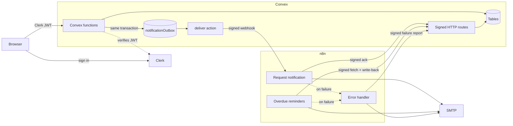
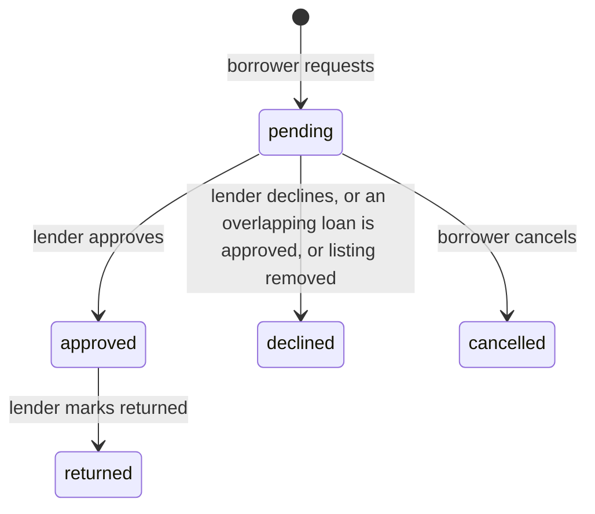

# LendLoop

A neighborhood tool-lending board: neighbors list tools, request to borrow, and get automated notifications and overdue reminders through n8n.

**Stack:** Next.js 16 (App Router), Clerk, Convex, n8n, TypeScript.

- [Local setup](#local-setup)
- [Environment variables](#environment-variables)
- [Architecture](#architecture)
- [Roles and access control](#roles-and-access-control)
- [Security decisions](#security-decisions)
- [Data minimization](#data-minimization)
- [Reliability and failure handling](#reliability-and-failure-handling)
- [Testing](#testing)
- [Decisions and trade-offs](#decisions-and-trade-offs)

For what would change before running this for real, see [PRODUCTION.md](./PRODUCTION.md).

## Local setup

You need Node 20.9+, Docker, and a free [Clerk](https://clerk.com) account. Convex runs locally with no account, so Convex and n8n can reach each other without a tunnel.

### 1. Install and start Convex

```bash
npm install
CONVEX_AGENT_MODE=anonymous npx convex dev
```

Leave this running. It creates a local deployment and writes `CONVEX_DEPLOYMENT` and `NEXT_PUBLIC_CONVEX_URL` to `.env.local`. It will report that `CLERK_JWT_ISSUER_DOMAIN` is missing until step 2 is done. (To use a Convex account, run plain `npx convex dev` instead and see [Using Convex cloud](#using-convex-cloud).)

### 2. Connect Clerk

1. Create a Clerk application with email sign-in.
2. In the Clerk dashboard, open **Integrations → Convex** and activate it. This creates a JWT template named `convex`. Keep its default claims, as LendLoop reads `given_name`, `email` and `email_verified`.
3. Copy your **Frontend API URL** (like `https://your-app.clerk.accounts.dev`) and set it on Convex:
   ```bash
   CONVEX_AGENT_MODE=anonymous npx convex env set CLERK_JWT_ISSUER_DOMAIN https://your-app.clerk.accounts.dev
   ```
4. Add your API keys to `.env.local`:
   ```bash
   NEXT_PUBLIC_CLERK_PUBLISHABLE_KEY=pk_test_...
   CLERK_SECRET_KEY=sk_test_...
   NEXT_PUBLIC_CLERK_SIGN_IN_URL=/sign-in
   NEXT_PUBLIC_CLERK_SIGN_UP_URL=/sign-up
   ```

### 3. Start n8n

```bash
CONVEX_AGENT_MODE=anonymous npm run setup:integration   # generates secrets into .env, sets them on Convex
docker compose up -d
```

This starts:

| Service | URL | Purpose |
| --- | --- | --- |
| n8n | http://localhost:5678 | Create an owner account on first visit. Workflows are already imported and active. |
| Mailpit | http://localhost:8025 | A local inbox that catches every email the workflows send. |
| n8n-bootstrap | exits when done | Creates credentials from `.env`, imports and publishes the workflows. |

### 4. Start the app

```bash
npm run dev    # http://localhost:3000, or add -- -p 3100 if that port is taken
```

### 5. Make yourself an admin

Sign in once so your user exists, then:

```bash
CONVEX_AGENT_MODE=anonymous npx convex run admin:setRoleByEmail '{"email":"you@example.com","role":"admin"}'
```

### Try the automation

**Request notifications.** Use two accounts (two browser profiles, or Clerk's `+clerk_test` emails with code `424242`). List a tool with one and request it with the other. Each step lands in Mailpit, and appears on the loan's activity list.

**Overdue reminders.** The public API won't create a loan in the past, so an internal seed function backdates one:

```bash
CONVEX_AGENT_MODE=anonymous npx convex run seed:demo '{"borrowerEmail":"you@example.com"}'
npm run n8n:run-overdue      # runs now instead of waiting for 08:00 UTC
npm run n8n:run-overdue      # run again: no second email, no second record
```

**Failure handling.** Stop the mail server and watch failures surface under **Admin → Automation**:

```bash
docker compose stop mailpit
CONVEX_AGENT_MODE=anonymous npx convex run seed:demo
npm run n8n:run-overdue      # the run fails; the error workflow reports it
docker compose start mailpit
npm run n8n:run-overdue      # the failed reminder is retried and upgrades to sent
```

Stopping `n8n` instead shows the outbox side: new request emails wait with `network_error`, then deliver on their own after restart.

### Using Convex cloud

A cloud deployment can't reach `localhost`, so expose n8n (for example `cloudflared tunnel --url http://localhost:5678`) and set in `.env`:

```bash
N8N_REQUEST_WEBHOOK_URL=https://<your-tunnel>/webhook/lendloop-request-event
CONVEX_SITE_URL=https://<deployment>.convex.site
```

Then re-run `npm run setup:integration` and `docker compose up -d --force-recreate`.

## Environment variables

| Variable | Set on | Secret | Purpose |
| --- | --- | --- | --- |
| `NEXT_PUBLIC_CONVEX_URL` | `.env.local` | No | Convex client URL. Written by `convex dev`. |
| `NEXT_PUBLIC_CLERK_PUBLISHABLE_KEY` | `.env.local` | No | Clerk frontend key. |
| `CLERK_SECRET_KEY` | `.env.local` | **Yes** | Clerk backend key. |
| `NEXT_PUBLIC_CLERK_SIGN_IN_URL` | `.env.local` | No | Set to `/sign-in`, so auth stays on this app instead of the hosted Clerk portal. |
| `NEXT_PUBLIC_CLERK_SIGN_UP_URL` | `.env.local` | No | Set to `/sign-up`, for the same reason. |
| `CLERK_JWT_ISSUER_DOMAIN` | Convex | No | Issuer Convex validates JWTs against. |
| `CONVEX_TO_N8N_SECRET` | Convex, `.env` | **Yes** | Signs Convex → n8n webhooks. |
| `N8N_TO_CONVEX_SECRET` | Convex, `.env` | **Yes** | Signs n8n → Convex requests. |
| `N8N_REQUEST_WEBHOOK_URL` | Convex, `.env` | No | Where Convex sends events. |
| `N8N_ENCRYPTION_KEY` | `.env` | **Yes** | Encrypts n8n's credential store. |
| `CONVEX_SITE_URL` | `.env` | No | Convex HTTP actions, as seen from the n8n container. |
| `OPS_EMAIL` | `.env` | No | Receives alerts from the error workflow. |
| `SMTP_HOST`, `SMTP_PORT`, `SMTP_SECURE`, `SMTP_USER`, `SMTP_PASSWORD` | `.env` | Password: **Yes** | Mail server. Defaults to Mailpit. |

`.env` and `.env.local` are gitignored. `.env.example` and `.env.local.example` list everything.

## Architecture



### Code layout

```
app/                  Routes. (app)/ holds the signed-in area.
components/           UI, grouped by feature. Modals load through next/dynamic.
convex/
  schema.ts           Tables and indexes, with the reasoning for each.
  lib/functions.ts    authedQuery / adminMutation etc. Where authorization lives.
  lib/hmac.ts         Signing and verification.
  tools.ts loans.ts   Feature functions, with their ownership rules.
  admin.ts            Admin-only functions, and the internal role change.
  http.ts             Signed routes for n8n. The only code that accepts its traffic.
  automation/
    outbox.ts         Convex → n8n delivery: claim, retry, give up, recover.
    inbound.ts        n8n → Convex handlers, all idempotent.
    activity.ts       Per-loan automation history.
  seed.ts             Internal demo data.
n8n/workflows/        Exported workflow JSON, free of secrets.
n8n/bootstrap/        Turns environment variables into n8n credentials.
tests/                Convex function tests and workflow guards.
```

### Loan lifecycle



*Overdue* isn't a stored state. It's an `approved` loan whose end date has passed, derived from the dates so it can't drift.

### Workflows

**Request notification.** Webhook (raw body) → compute HMAC → verify in constant time, plus timestamp → 401 if invalid → compose → send email (3 tries) → signed ack to Convex → respond 200. If sending fails, the run fails: the error workflow reports it, n8n returns 500, and the outbox retries.

**Overdue reminders.** Daily at 08:00 UTC → signed fetch of loans owed a reminder → one item per loan → send email (3 tries, continue on error) → signed write-back of `sent` or `failed` → fail the run if any failed, which triggers the error workflow. One bad address doesn't block the other reminders.

**Error handler.** Error trigger → scrub addresses from the message → signed report to Convex (shown under Admin → Automation) → email ops. The email still goes if Convex is what's down.

## Roles and access control

Authorization is enforced inside Convex functions. The UI hides what you can't do as a courtesy, and `proxy.ts` only saves a redirect. Neither is a security boundary.

| Action | Anonymous | User | Admin |
| --- | --- | --- | --- |
| See available tools (name and category only) | ✓ | ✓ | ✓ |
| See all tools with details and status | | ✓ | ✓ |
| Create a listing | | ✓ | ✓ |
| Edit a listing | | Own | Own |
| Delete a listing | | Own | Any, with a reason |
| Request to borrow | | Others' tools | Others' tools |
| Approve, decline, mark returned | | Own tools | Own tools |
| Cancel a request | | Own requests | Own requests |
| View all loans, automation health | | | ✓ |
| Mark a Trusted Lender | | | ✓ |
| Change anyone's role | | | CLI or dashboard only |

How this is built:

- **Secure by construction.** Feature modules build functions from `authedQuery`, `authedMutation`, `adminQuery` and `adminMutation`, which resolve the caller before the handler runs.
- **Identity comes from the verified JWT**, never from arguments. There is no `userId` parameter to forge.
- **The role is read from the database on each call**, so revoking admin takes effect immediately, not when a token expires.
- **Role changes are internal functions**, unreachable from any client. No code path lets a client escalate.
- **Admin is deliberately not a superuser.** The brief gives admins moderation powers, not the right to approve loans or edit other people's listings, so tests confirm they can't.

## Security decisions

### Signing the integration

Both directions sign the same way:

```
x-lendloop-timestamp: <unix seconds>
x-lendloop-signature: v1=<hex HMAC-SHA256 of "timestamp.METHOD.path.body">
```

- **Raw bytes are signed and verified.** Re-serializing JSON can change bytes, so both sides work from the exact body. n8n parses JSON only after the signature passes.
- **Method and path are in the signature**, so a valid signature for one endpoint can't be replayed against another.
- **A 5-minute timestamp window** limits replay, and idempotent write-backs make any replay inside it harmless.
- **Comparison is constant-time:** `crypto.subtle.verify` in Convex, an XOR loop in n8n.
- **Each direction has its own key**, so one leaking can't forge the other direction.
- **Convex fails closed.** A missing secret returns 503, never an unverified pass-through.
- **All n8n routes go through one `signedRoute` wrapper**, so a new route can't forget the check.

### Keeping secrets out of the repo

Plain-text secrets exist only in `.env` (gitignored), Convex's environment, and briefly the bootstrap container. n8n holds them in its encrypted credential store.

- Workflow JSON references credentials by ID. Signing uses the Crypto node's credential, so Code nodes never see a secret. A test fails if secrets, secret-shaped strings or `$env` appear in the exports.
- `N8N_BLOCK_ENV_ACCESS_IN_NODE` stays on, so a workflow can't read the encryption key. The Convex URL is substituted at import time to make this possible.
- The running n8n container doesn't get the HMAC secrets as environment variables. Only the one-shot bootstrap container does.

### Other measures

- **Input validation on the server:** length limits, enum validators, real calendar dates, and no control characters in tool names, because they flow into email subjects (header injection).
- **Emails are plain text**, so user-supplied names can't inject HTML.
- **Error messages** returned to clients are written by hand and never contain another user's details. Convex redacts anything else.
- **Abuse limits:** caps on listings per user, open requests per user, loan length, and the public list's size.
- **Ports bind to loopback** in Compose, and the app sets basic security headers.

## Data minimization

| Where | Gets | Deliberately doesn't get |
| --- | --- | --- |
| Public page | Tool name, category | IDs, owners, condition, description |
| Other signed-in users | Owner's first name, Trusted Lender badge | Surname, email, who currently has a tool |
| Request form | Booked date ranges | Who booked them |
| A loan's two parties | Each other's email, **only while the loan is approved** | Email before approval or after return |
| Admins | First name, masked email (`j***@example.com`) | Full email |
| Clerk → Convex | First name, verified email | Surname, avatar, phone (never stored) |
| Notification webhook | Recipient's email and first name, other party's first name, tool name, dates | Other party's email, user IDs, tool details |
| Overdue endpoint | Borrower's email and first name, tool name, dates | Lender identity, tool details |
| Write-backs to Convex | Loan ID, date, `sent` or `failed` | Raw SMTP errors, which can quote addresses |
| Outbox table | References and an error code | Email addresses or bodies. The payload is built at send time, and response bodies are never stored. |
| n8n execution logs | Failed runs only, pruned after 7 days | Successful runs are not retained |

## Reliability and failure handling

### Convex → n8n: a transactional outbox

A status change and its outbox row commit in the same transaction, so a notification can't be lost after the change succeeds, or sent for a change that rolled back. Delivery then runs separately:

- **Retries** back off over 6 attempts (30s, 2m, 10m, 30m, 1h).
- **A lease** set in a serialized mutation stops two workers sending the same event.
- **A cron every 10 minutes** recovers rows whose scheduled job was lost. Convex runs scheduled actions at most once, so this is needed.
- **After the last attempt** the row becomes `failed`, and admins can see and retry it.

### n8n → Convex: idempotent write-backs

| Write | Idempotency key | On repeat |
| --- | --- | --- |
| Reminder status | `(loanId, reminderDate)` | No new row. `failed` can upgrade to `sent`; `sent` is final. |
| Notification ack | Outbox row ID | No-op. |
| Workflow failure | n8n execution ID | No new row. |

The key is built from values with real meaning, not a random token from the caller, so "one reminder per loan per day" holds however a retry arrives. The overdue list also excludes loans already reminded today, which is what stops a re-run from sending a second email.

### What happens when things break

| Failure | Result | Where you see it |
| --- | --- | --- |
| n8n is down | Outbox retries, delivers after recovery | Admin: emails waiting |
| Email fails on a notification | Run fails, 500, outbox retries | Admin: failed runs, Mailpit once recovered |
| Email fails on a reminder | Others continue; marked `failed`; retried on the next run | Admin: failed runs, loan activity |
| Ack to Convex is lost | The 200 still marks it delivered, no re-send | n8n logs |
| 200 response is lost | The ack already marked it delivered, no re-send | Nothing to see |
| Convex is down during a run | HTTP node retries; the error workflow emails ops | Ops email |
| Forged or stale request | 401, nothing runs | Convex logs |
| The daily schedule stops firing | No error is raised, but the heartbeat goes stale | Admin: red `Stale` badge after 26 hours |
| Retries exhausted | Row marked `failed` | Admin: retry button |

### Delivery guarantee

Delivery is **at-least-once**, and exactly-once email isn't possible over SMTP and HTTP. A duplicate needs an email to succeed and then both the ack and the response to be lost, or a reminder's write-back to fail on every retry. I chose this side deliberately: a rare duplicate reminder is better than a silently missed one.

## Testing

```bash
npm test             # 77 tests, no services needed
npm run typecheck
npm run lint
```

- `tests/rbac.test.ts`: every role against every protected action, and the exact shape of the public response.
- `tests/loans.test.ts`: date rules, state transitions, overlap handling, input validation.
- `tests/integration.test.ts`: signature tampering and replay, route protection, idempotent write-backs, outbox retry, lease and give-up.
- `tests/workflows.test.ts`: static checks on the exported JSON, covering secrets, credentials, retries and error routing.

The workflows themselves can only be proven against a live n8n. The [Try the automation](#try-the-automation) steps are the manual test plan.

## Decisions and trade-offs

- **Role in Convex rather than Clerk metadata.** Authorization data then lives with the code that enforces it, and revocation is immediate instead of waiting on token expiry.
- **Only the lender can mark a loan returned.** The person who got the tool back is the one who can confirm it. Otherwise a borrower could end their own overdue reminders by claiming a return.
- **Admins removing a listing leave approved loans open.** The tool may still be out, so the return flow and reminders must keep working. Listings are soft-deleted for this reason.
- **Approving a request auto-declines overlapping ones.** Otherwise those neighbors wait on a request that can't succeed.
- **An unreturned overdue loan keeps blocking the tool**, however far past its end date. Availability follows where the tool physically is.
- **Availability is denormalized on the tool**, so the public list is one index read. Mutations keep it current, and a daily cron handles loans whose start date arrives. A Convex query using `Date.now()` wouldn't re-run when the date changes.
- **Dates are UTC calendar days.** Simple and unambiguous, at the cost of "today" flipping at a different local hour for each person. That's fine for day-granularity loans in one neighborhood, but see PRODUCTION.md.
- **Mail goes through Mailpit by default**, so the whole flow is real SMTP with no provider signup. Pointing at a real provider is an `.env` change.
- **Loading states.** The public page uses a real `<Suspense>` boundary around a server component. Signed-in views use Convex's reactive `useQuery`, which returns `undefined` while loading and doesn't suspend, so they render matching skeletons from that state instead.
